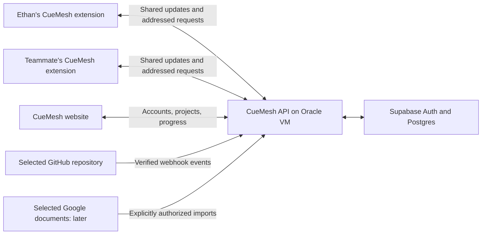

> **Historical proposal — not the implemented API.** The user subsequently required server/ v1 accounts. Root docs/cloud-api.md and docs/integration-contract.md and website/docs/BACKEND_HANDOFF.md are authoritative. Supabase, OAuth, cookie/CSRF, context revisions and work items below are unshipped proposals.

# CueMesh team workspaces: accounts, shared context, and agent handoffs

Status: proposed feature and implementation handoff, November 7, 2026. This document does not implement authentication, provision Supabase, connect accounts, or change the shared extension contract.

Baseline: `docs/integration-contract.md` at repository commit `60660319bddbe78b95aac668a411ca854d22f98d`, plus the local website's `src/lib/contracts.ts` and `src/lib/api.ts`. The current frontend is being developed separately. This proposal lives under `website/` so both developers can review the addition before adopting a shared protocol.

## 1. Product outcome

Each person has a CueMesh account and their own connected extension. People join a shared project, divide responsibilities, and let their CueMesh agents exchange relevant progress, questions, and handoffs. Both agents work from the same accepted requirements and interface decisions while retaining their own tools, credentials, and permissions.

Example: Ethan builds the frontend; a teammate builds the backend. Ethan's CueMesh reports which API fields the frontend needs. The teammate's CueMesh receives that request, checks the backend work, and returns a response with the relevant commit or contract revision. Ethan's CueMesh notices the response and updates its plan. The website shows who owns each part, what changed, and what is waiting on someone.

Suggested product description:

> Your team, working from the same context. Connect your accounts, divide the work, and let your CueMesh agents exchange updates and handoffs while you stay in control.

The shared state and coordination rules need to be built in CueMesh. Supabase provides useful infrastructure; it does not itself make agents understand a project or coordinate correctly.

## 2. First usable version

| Capability         | First version                                                           | Follow-up                                              |
| ------------------ | ----------------------------------------------------------------------- | ------------------------------------------------------ |
| Personal account   | Google and GitHub sign-in; account settings                             | More identity providers                                |
| Team access        | Create workspace, invite teammate, remove member                        | Organizations and multiple admin roles                 |
| Shared project     | Goal, requirements, accepted decisions, repository reference            | Multiple repositories and richer search                |
| Responsibilities   | Work items with owner, scope, dependencies, status                      | Automated planning and assignment                      |
| Progress           | Shared updates with evidence and last-sync time                         | Richer automatic change summaries                      |
| Agent coordination | Addressed requests, acknowledgement, replies, blockers                  | More elaborate delegation workflows                    |
| GitHub             | Selected repository, commits, PRs, changed files                        | Agent-created PRs after separate authorization         |
| Google             | Sign-in first; project context can initially use pasted notes and links | Explicit Drive connection and selected document import |
| Execution          | Each person's connected extension executes its own authorized work      | Optional IDE or desktop worker                         |

Implement in vertical slices: accounts and membership, then shared context and manual updates, then real extension-to-extension handoffs, then automatic GitHub updates. Account connections should show their actual setup state rather than simulate a successful connection.

Do not make email, calendar, every Google service, autonomous merging, or an always-running cloud agent prerequisites for the first demo.

## 3. Architecture and ownership



- Website: keep the current React/TypeScript static build, served through Nginx on the Oracle VM. Add account, team, context, ownership, and handoff screens.
- Backend: handle OAuth callbacks, sessions, workspace permissions, durable messages, context versions, and connector credentials. Supabase Auth and Postgres sit behind this service.
- Extension: collect approved context, call models with local AI keys, receive requests, and execute within the local user's grants and budget. It reports a shareable result back to the project.
- GitHub: holds code, branches, commits, and PRs. CueMesh holds the coordination state and links to that evidence.

The website does not directly operate either person's browser. A request delivered to an extension is input to that extension's authorization and execution policy; it is not automatic permission to click, submit, run code, or spend money.

A Chrome extension alone does not establish access to unsaved IDE files, a terminal, or a local repository. For this version, progress comes from approved manual updates, extension work, and GitHub commits/PRs. Local development automation requires a separately implemented worker or IDE integration.

## 4. Accounts and service connections

### CueMesh identity

Use one internal user ID from Supabase Auth for memberships, ownership, messages, and audit records. Names and email addresses are display attributes, not authorization keys. Supabase documents both [Google sign-in](https://supabase.com/docs/guides/auth/social-sign-in/auth-google) and [GitHub sign-in](https://supabase.com/docs/guides/auth/social-sign-in/auth-github).

Offer “Continue with Google” and “Continue with GitHub.” Account settings can link a second sign-in identity while already authenticated. Use the provider-supported identity-linking flow; do not implement account merging by trusting an email string sent by a client. Supabase supports [identity linking](https://supabase.com/docs/guides/auth/auth-identity-linking); manual linking requires configuration and is currently documented as beta.

Preserve the website's existing same-origin API and session shape. Recommended implementation: backend-owned OAuth authorization-code flow with PKCE, exact callback allowlists, and CSRF/state protection. The backend stores Supabase session credentials server-side and issues a Secure, HttpOnly CueMesh session cookie with an appropriate SameSite policy. Continue CSRF protection for cookie-authenticated mutations. Do not put provider tokens into URLs, public runtime configuration, logs, or shared project records.

### GitHub repository connection

Signing in identifies the person. Connecting a repository is a separate permission grant.

Use a GitHub App installed on selected repositories. Request only the repository permissions needed to read the selected content, commits, and PRs. GitHub Apps support [specific repositories, scoped permissions, and webhooks](https://docs.github.com/en/apps/creating-github-apps/about-creating-github-apps/about-creating-github-apps).

Record repository ID, installation ID, linked workspace, and the authorized installer. Verify the completed installation and selection server-side; never accept an arbitrary installation ID as proof of access. A private repository connection requires an explicit decision to share its imported content with workspace members. Membership in CueMesh must not silently expand access to unrelated repositories.

Validate webhook signatures over the raw request body before parsing or processing, deduplicate delivery IDs, and check the installation/repository association. Follow GitHub's [webhook validation guidance](https://docs.github.com/en/webhooks/using-webhooks/validating-webhook-deliveries). Store commit SHAs and PR URLs as evidence. A push is evidence that code changed; it does not establish that the feature works.

### Google connection

Use basic identity scopes for sign-in. Later, a distinct “Add Google Drive source” flow requests document access when needed. Google recommends [incremental authorization](https://developers.google.com/identity/protocols/oauth2/web-server#incrementalAuth).

For selected-document import, evaluate Google Picker with `drive.file`. That scope can authorize changes to selected files as well as access, so describe its consent honestly even if the first CueMesh feature only imports. Avoid requesting access to all Drive files or Gmail by default. See Google's [Drive scope guidance](https://developers.google.com/workspace/drive/api/guides/api-specific-auth).

Before importing private content, show that the copied excerpt will become visible to the project team. Store source identity, version/retrieval time, and sharing provenance. Disconnect stops future sync and provides an option to remove imported snapshots; do not imply that disconnecting can retract content members already saw.

### Credential boundaries

AI API keys remain in each person's extension, as required by the current contract. GitHub installation credentials and future Google connector refresh tokens are different credentials: keep them encrypted on the backend with keys outside the database, in a schema inaccessible to ordinary clients. Shared tables contain connection metadata only. Supabase administrative secrets also stay server-side.

## 5. Workspaces, membership, and project privacy

Use three workspace roles for the first version:

| Role   | Permissions                                                                                                |
| ------ | ---------------------------------------------------------------------------------------------------------- |
| Owner  | Manage invitations, members, project connections, and accepted context; participate in work                |
| Member | Read shared project data, propose context changes, publish their updates, and participate in assigned work |
| Viewer | Read shared project data; no agent requests, assignments, or mutations                                     |

All members of one workspace can read that workspace's shared projects in this version. Separate private project ACLs can come later. Personal extension runs and raw activity remain private to their original user even when a related project is shared.

Invite acceptance requires an authenticated account, an unexpired one-use token, and an atomic membership update. Store token hashes, not raw invitation tokens. If an invite is bound to an email, verify the authenticated email; otherwise clearly label it a bearer invite link. Owner creation and invitation acceptance must not permit self-escalation. Do not allow removal of the last owner without ownership transfer.

Enforce membership and role checks on every API operation, event replay, attachment download, and device request. Use RLS for exposed Supabase tables and test database access independently of the API. Administrative keys can bypass RLS, so privileged backend paths require their own authorization checks. See [Supabase RLS guidance](https://supabase.com/docs/guides/database/postgres/row-level-security).

Removing a member revokes their project access and device grants for that workspace, ends active project streams, and invalidates relevant caches. Content already downloaded cannot be remotely erased from a person's possession.

## 6. What “the same context” means

The project has an accepted, versioned context snapshot containing:

- Project goal and definition of done.
- Agreed requirements and design references.
- Responsibilities and file/module ownership conventions.
- Interface contracts, schemas, and accepted decisions.
- Open blockers and dependencies.
- Source references pinned to a commit, document version, or retrieval time.

Each agent starts work with the accepted context revision plus only the shared material relevant to its assignment. It reports the revision it used. Different agents need consistent decisions, not identical copies of every conversation.

Agent suggestions are proposals. The project owner accepts shared requirement/interface changes for the first version. A member can propose an update; they cannot silently replace the accepted contract. Later, approval can be delegated to a named interface owner.

Context updates use compare-and-swap: submit `expectedRevision`; the server commits only if it still matches. Otherwise return `409 CONTEXT_CONFLICT` with the latest revision. Publish the context update and corresponding event in one transaction. Notify affected work items when a relevant interface changes; unrelated progress updates should not restart all agents.

Keep recent decisions and a compact summary in working context, with links to evidence. A generated summary retains the IDs of the records it summarizes and never supersedes the accepted contract by itself.

## 7. Structured agent handoffs

Expose an “Agent handoffs” panel with the initiating person, agent, recipient, related work item, request, evidence, and lifecycle state.

Message kinds: `progress`, `question`, `answer`, `handoff`, `blocker`, `context_proposal`. A message can address a project member; the server routes it to that member's active, authorized project session. If several devices are connected, only one may claim executable work.

An illustrative request payload, using placeholder IDs:

```json
{
  "schemaVersion": 1,
  "clientMessageId": "uuid-created-by-sender",
  "projectId": "shared-project-uuid",
  "threadId": "coordination-thread-uuid",
  "replyToMessageId": null,
  "recipientUserId": "backend-owner-uuid",
  "workItemId": "frontend-sign-in-work-item-uuid",
  "kind": "question",
  "contextRevision": 4,
  "body": {
    "summary": "The account screen needs the signed-in user's name and avatar.",
    "request": "Can you confirm these fields in the shared session contract?",
    "evidence": []
  }
}
```

The server derives the sender identity from authentication, validates project membership and every referenced object, assigns the message ID and timestamp, and persists it before delivery. Names, agent roles, and a client-provided `senderUserId` never establish identity.

Keep transport and work completion separate:

- `queued`: persisted and waiting for the recipient.
- `delivered`: the authorized recipient session acknowledged receipt.
- `accepted`: the recipient accepted responsibility under its local policy.
- `resolved`, `declined`, `cancelled`, or `expired`: the request has a terminal outcome.

Delivery does not mean work started or succeeded. Replies reference the original message and provide evidence or an explicit uncertainty. A resolved request can mean “question answered”; completion of a code work item separately requires its acceptance criteria and evidence.

Use an atomic claim with a renewable lease for executable requests. A lease expiry permits recovery but does not prove an earlier action never happened. Before retrying side effects, reconcile with the external system; use operation-level idempotency keys where supported. Do not promise exactly-once execution across browser actions and external services.

### Check-in policy

Check in when a work item changes state, a relevant commit/PR arrives, an interface proposal is accepted, or a dependency becomes blocked/unblocked. Coalesce rapid updates. Use an explicit “Ask for update” action when no new evidence exists.

Agent messages and source text are untrusted input. They cannot change the receiving user's tools, budget, sharing policy, or approval rules. Users opt into which projects may exchange automatic summaries and which task types can run automatically. Each user's own model budget is charged to their own calls; shared spending needs a separate design.

Suggested initial safeguards: at most two automatic replies per agent in one request thread, at most four automatic messages total, and no new thread created automatically to evade that limit. Stop on a terminal answer, repeated content, budget exhaustion, missing permission, or the message limit. Escalate unresolved ambiguity to a visible owner decision. These are proposed defaults, not model-provider limits.

## 8. Durable state and reconnect behavior

Postgres is the source of truth for messages, context, and work status. Start with cursor-based API polling while a website view or extension session is active; this fits the current website client. Realtime can reduce latency later without changing storage semantics.

Persist outbound messages locally before upload. The server enforces a unique `(senderDeviceId, clientMessageId)` and returns the original result on retry. Reusing that key with different content returns a conflict. Reconnecting devices first refresh membership and accepted context, then replay missed events and resume eligible requests.

Maintain a server-assigned sequence per shared project, separate from the legacy `(runId, seq)`. Allocate it under a transactionally locked project counter so concurrent commits cannot cause a client to skip a late-committing lower sequence. Apply state changes and append their event atomically. An initial snapshot includes a cursor from the same consistent database snapshot; subsequent reads request events after that cursor. Deduplicate on `(projectId, seq)` and advance only after applying a complete returned page.

Chrome extension workers can stop when idle. Persist cursors and pending work in extension storage, resume on supported startup/wake events, and show “offline” or “last synced” when appropriate. Do not claim the recipient is continuously working while its browser is closed. See [Chrome's service-worker lifecycle](https://developer.chrome.com/docs/extensions/develop/concepts/service-workers/lifecycle).

If Supabase Realtime is added, use private channels with membership-based authorization. Broadcast/presence authorization is separate from ordinary table access, and Realtime notifications are not the durable inbox. A simple option with the current cookie-based frontend is for the backend to forward authorized updates through SSE; direct browser Supabase subscriptions require an explicit user-token design. See [Realtime authorization](https://supabase.com/docs/guides/realtime/authorization).

For removal/revocation, recheck access during replay and delivery and close active streams. Do not assume a channel joined before a membership change immediately loses access without implementing and testing that behavior.

## 9. Proposed data model

Keep legacy `Project`, `Run`, `Task`, `Artifact`, and `Event` payloads compatible. Use separate collaboration records; a team work item is not an existing agent subtask.

| Record                     | Key fields and purpose                                                                        |
| -------------------------- | --------------------------------------------------------------------------------------------- |
| `profiles`                 | `user_id`, display name, avatar; references Auth user                                         |
| `workspaces`               | ID, name, created time                                                                        |
| `workspace_members`        | Unique workspace/user pair, role, active state                                                |
| `workspace_invites`        | Workspace, token hash, invited role, expiry, consumed time                                    |
| `project_spaces`           | Existing project ID, workspace ID, accepted context revision; only shared projects have a row |
| `work_items`               | Project, title, human owner, scope, status, version, acceptance criteria                      |
| `work_item_dependencies`   | Dependent and prerequisite work items; same-project constraint; reject cycles                 |
| `context_revisions`        | Project, revision, accepted snapshot, author/approver, evidence refs                          |
| `context_proposals`        | Proposed patch, base revision, proposer, review state                                         |
| `agent_sessions`           | User, device, project grants, capabilities, last seen, revocation                             |
| `coordination_messages`    | Sender, recipient, thread, kind, work item, context revision, body, lifecycle                 |
| `message_claims`           | Message, claiming session, lease expiry, execution state                                      |
| `project_events`           | Project, server sequence, event kind, minimal payload, created time                           |
| `project_sources`          | Selected repo/document references, version, import/sharing provenance                         |
| `shared_artifacts`         | Explicitly published copies with project audience and source owner                            |
| Private credential records | Server-only connector secrets and device-token hashes; never team-readable                    |

Legacy project IDs remain strings for compatibility. New server-created IDs can be UUIDs. All API timestamps remain Unix milliseconds. The server validates ownership before attaching a project to a workspace; it must not turn an existing personal project into shared data merely because someone knows its ID.

Suggested team work states: `todo`, `in_progress`, `blocked`, `in_review`, `done`. Updates require `expectedVersion`. The assigned person changes their work status; the owner can reassign with an audit event. Module/path ownership is a coordination convention, not a replacement for Git branch protections or review.

Existing private runs can be referenced by the owner when preparing a shared update, but another member cannot dereference that private run through its ID. Shared evidence must be independently authorized and explicitly published.

## 10. Proposed API surface

These routes are a proposal for the backend developer, not implemented endpoints. Keep the website's existing `/api/web/v1` session and personal-run endpoints working. New team routes use a separate `team` namespace. Object bodies follow the record definitions above and should become runtime-validated schemas plus generated OpenAPI once the protocol is agreed.

| Route                                                    | Purpose                                                         |
| -------------------------------------------------------- | --------------------------------------------------------------- |
| `GET /api/web/v1/auth/:provider/start`                   | Start configured Google/GitHub sign-in; validate return route   |
| `GET /api/web/v1/auth/callback`                          | Validate state, exchange code, establish session                |
| `GET, POST /api/web/v1/team/workspaces`                  | List memberships or create workspace                            |
| `POST /api/web/v1/team/workspaces/:id/invitations`       | Owner creates expiring invitation                               |
| `POST /api/web/v1/team/invitations/accept`               | Authenticated, atomic invite acceptance                         |
| `GET, POST /api/web/v1/team/workspaces/:id/projects`     | List or create shared projects                                  |
| `GET /api/web/v1/team/projects/:id/snapshot`             | Context, work items, permitted messages, sync cursor            |
| `POST /api/web/v1/team/projects/:id/context-proposals`   | Propose context change at an expected revision                  |
| `POST /api/web/v1/team/context-proposals/:id/accept`     | Owner accepts against the current revision                      |
| `POST /api/web/v1/team/projects/:id/work-items`          | Create owned work item                                          |
| `PATCH /api/web/v1/team/work-items/:id`                  | Authorized state/assignment change with expected version        |
| `GET, POST /api/web/v1/team/projects/:id/messages`       | Read or publish permitted coordination messages                 |
| `POST /api/web/v1/team/messages/:id/transitions`         | Authorized lifecycle transition with expected version           |
| `GET /api/web/v1/team/projects/:id/events?after=cursor`  | Replay persisted project updates                                |
| `POST /api/web/v1/team/workspaces/:id/github/connect`    | Start selected-repository installation/connection flow          |
| `GET /api/web/v1/team/github/callback`                   | Validate installation state and authorized repository selection |
| `POST /api/integrations/github/webhook`                  | Signature-validated GitHub ingestion                            |
| `DELETE /api/web/v1/team/workspaces/:id/members/:userId` | Owner removes member and revokes workspace grants               |

The extension needs new authenticated `/api/ext/v1/team/...` routes for project snapshots, event replay, message publication, inbox retrieval, message claims/lease renewal, and lifecycle updates. They call the same authorization and persistence services as the website. Limit access to the paired user's current project grants. A read-only old pairing token must not silently acquire team execution capabilities.

Recommended next pairing flow: one-use, short-lived pairing code exchanged for a revocable device credential. This requires an agreed extension-contract revision because the current frontend proposal exposes a one-hour token directly. Existing pairing behavior remains until both sides migrate. Device permissions describe both data access and whether inbound task execution is enabled.

For errors, preserve `{ "error": { "code", "message", "requestId" } }`. Use `401` for missing/expired authentication, `403` for a forbidden action on a visible resource, `404` for inaccessible objects when hiding their existence, `409` for stale versions or idempotency conflicts, and `429` for rate limits. Derive sender, role, and workspace access from server-authenticated state, not request fields. Paginate messages/events and enforce payload-size limits.

For all state-changing operations, define allowed transitions, authorization, expected version, and retry behavior before shipping. Atomically commit each accepted mutation and its project event. Never mark a UI action saved until the server acknowledges it; demo behavior must remain visibly labeled.

## 11. Website experience

Use the current website's paper/ink surfaces, citron accent, compact typography, and existing motion tokens. Keep the landing page scroll sequence intact; introduce team collaboration as a focused product scene after the existing context-and-task story.

Workspace additions:

1. **Account and connections:** Google/GitHub sign-in, linked identities, actual service connection state, and paired devices.
2. **Workspace switcher:** Personal workspace and joined team workspaces, with a visible current project.
3. **Project overview:** Goal, repository, accepted context version, current owners, and blockers.
4. **Work board:** Frontend/backend responsibilities, dependencies, acceptance criteria, and PR evidence. Retain the existing agent-run view separately.
5. **Shared context:** Requirements, accepted API decisions, source revisions, and proposed changes awaiting an owner.
6. **Agent handoffs:** Requests and replies with sender, recipient, context version, status, and evidence. Include “Ask for update” and “Review proposal.”
7. **Team settings:** Invitation link, member roles, repository sharing, and project-level agent policies.

Required states: signed out, OAuth unavailable/cancelled, loading, empty team, invite expired, forbidden, recipient offline, reconnecting, pending delivery, stale context, disconnected source, and failed sync. Display “last seen” separately from “working.” Presence is not proof of execution.

For frontend development, use a clearly labeled demo adapter with two people, two work items, a context proposal, and a handoff thread. Live mode must surface an unavailable backend rather than silently substitute sample success.

## 12. Changes that require the shared protocol to evolve

The repository's current [integration contract](https://github.com/Harry1667/CueMesh/blob/main/docs/integration-contract.md) describes mostly extension-to-website reporting and limits raw event visibility to the original account. This feature adds bidirectional coordination and a separately authorized shared audience.

Adopt these additions together when ready:

- Workspace membership and a mapping from shared projects to workspaces.
- Explicitly published summaries and artifacts with project audience.
- Device/project grants and an extension inbox for requests.
- Message lifecycle, retry rules, versioned context, and project-level event cursors.
- Compatibility negotiation so old extensions continue personal reporting without receiving unsupported team requests.

Keep the legacy `agent_message` and `mention` events scoped to their original run. They are not automatically cross-user messages. Do not make all `tool_call.args`, browser inputs, screenshots, browsing history, prompts, or raw transcripts team-visible. Publish only approved project context and summaries. A redaction filter is a supplement to explicit selection, not a guarantee that arbitrary logs are safe to share.

## 13. Implementation handoff

| Owner               | Concrete work                                                                                                                                                      |
| ------------------- | ------------------------------------------------------------------------------------------------------------------------------------------------------------------ |
| Frontend developer  | Build account/team screens, work board, shared-context view, handoff inbox, version/conflict/error states, and labeled demo adapter under `website/`               |
| Backend developer   | Configure Supabase Auth, schema and authorization, sessions/invites, versioned APIs, durable delivery, connector credentials, GitHub App/webhooks, and revocation  |
| Extension developer | Add project pairing/grants, selected sharing, durable outbox/inbox, request acknowledgement/claims, context refresh, budget limits, and local approval enforcement |
| Both module owners  | Agree collaboration schemas, ownership rules, compatibility version, and the explicit shared-contract update; review one another's integration PRs                 |

The pasted project notes assign backend work to a teammate, while the repository also assigns extension work to Harry. Treat backend and extension as responsibilities even if one person performs both; the repo has not established a new backend directory in this proposal. Keep website changes in `website/`, extension changes in `extension/`, and follow the repository's `web/...` and `ext/...` branch convention for those modules. Decide any new backend directory with its owner before implementation.

Suggested first vertical slice: two accounts join one project, see the same context, own different work items, exchange a persisted question and answer, and recover that thread after a disconnect. Then connect the extension inbox. Add automatic GitHub ingestion after the basic handoff is dependable.

## 14. End-to-end demo and acceptance checks

Demo scenario:

1. Ethan and a teammate sign in independently and join one project.
2. The project assigns the account UI to Ethan and its API to the teammate.
3. Ethan's CueMesh asks for a session-response field using context revision 1.
4. The teammate receives the request, accepts it, and supplies a proposed contract with evidence.
5. The project owner accepts revision 2; both agents see the new accepted context.
6. The teammate links a backend PR; Ethan links the frontend PR and reports integration evidence.
7. The project displays resolved dependencies, the two owners' contributions, and outstanding verification.

Release checks:

- Two real accounts can collaborate; a third non-member is denied via API and direct exposed database access.
- Google and GitHub identity linking does not create an unintended second project identity; sign-in alone does not imply repository or Drive access.
- Duplicate uploads/webhooks do not duplicate messages or task starts. An idempotency key reused with a different body is rejected.
- A reconnect replays missed events without skipping concurrently committed updates; the resulting UI matches a fresh snapshot.
- Two devices cannot hold the same active execution claim. A crash after a side effect triggers reconciliation rather than blind replay.
- Concurrent context or work-item updates return a conflict and preserve the accepted version.
- Removing a member blocks existing device credentials, event replay, downloads, and active delivery to that workspace.
- Shared context excludes private run payloads and credentials; unauthorized references cannot reveal another user's run or artifact.
- An offline recipient remains queued, not “working.” Worker restart preserves its cursor and pending requests.
- Agent replies stop at the configured message/budget limits. Peer content cannot grant new permissions or bypass local approval.
- A failed check, stale source, draft PR, and merged PR are displayed as distinct states; a model's “done” claim alone does not establish completion.
- Production OAuth callbacks, Nginx API routing, session renewal, and provider revocation are checked on the deployed origin.

These are implementation acceptance criteria. They have not been executed by creating this proposal.
